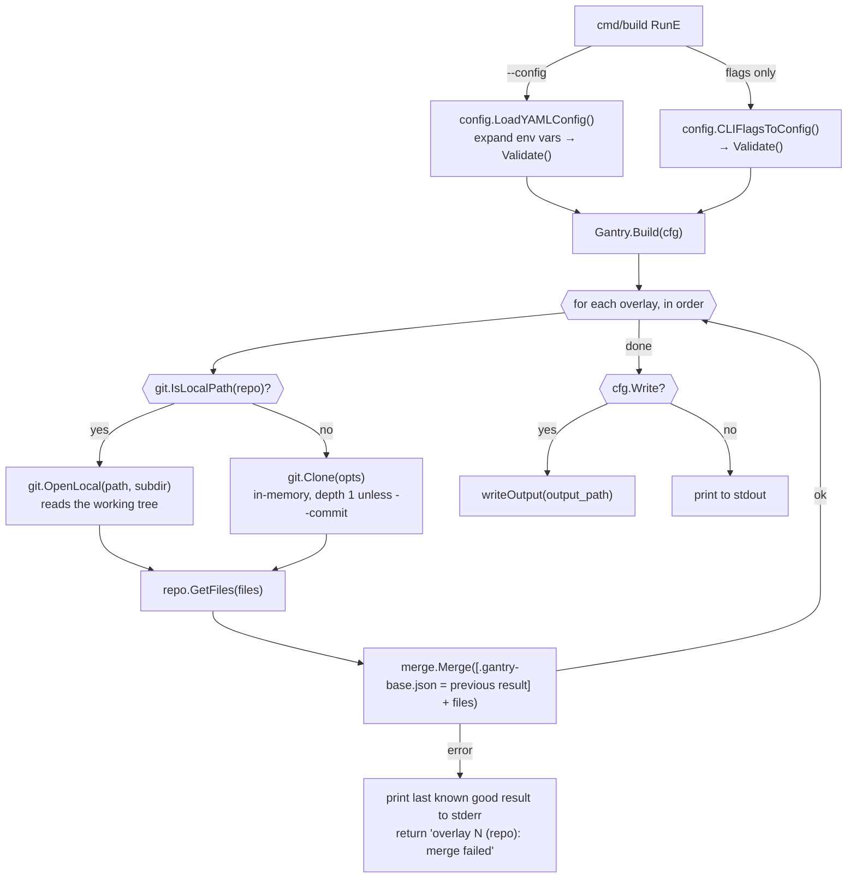

# Gantry internals

Gantry is a Cobra CLI that builds a `devcontainer.json` by fetching files from one or more git repositories (remote clones held in memory, or local checkouts), merging them left-to-right with Jsonnet, and printing the result or writing it to a file.

## Layout

| Path | Role |
|------|------|
| `main.go` | Root Cobra command. Wires stdout/stderr into `gantry.Gantry`, loads an optional `gantry.*` Viper config from the working directory, and binds flags to `GANTRY_*` environment variables. `version` is injected by GoReleaser. |
| `cmd/build/build.go` | `gantry build`. Builds a `config.BuildConfig` from `--config` (YAML) or from single-repo flags (`--repo`, `--files`, auth flags), then calls `Gantry.Build`. With `--config`, an explicit `--output-path` or `--write` overrides the YAML. |
| `pkg/config/config.go` | `BuildConfig` / `Overlay` / `OverlayAuth` (YAML schema, `version: 1`). `LoadYAMLConfig` reads the file, expands `${ENV_VAR}` in every string field (and a leading `~` in `ssh_key_path`), then validates. `CLIFlagsToConfig` builds a one-overlay config from flags. `Validate` enforces the rules listed below. |
| `pkg/gantry/build.go` | `Gantry.Build`, the pipeline orchestrator (see the flow below). `openRepoFunc` is a package variable so tests can inject a mock `git.Repository`. `writeOutput` creates parent directories (0700) and writes the file (0600) ending in exactly one newline. |
| `pkg/gantry/gantry.go`, `output.go` | The `Gantry` struct (`Out`, `Err` writers) and human-facing output helpers. Progress and errors go to `Err`; only the merged JSON goes to `Out`, so `gantry build > file` works. |
| `pkg/git/git.go` | `Repository` interface (`GetFiles`). `Clone` clones into memory (go-git v6 + billy memfs). `OpenLocal` opens a local checkout and reads its working tree. Also URL/SHA validation, `//subdir` parsing, auth, and size limits. |
| `pkg/merge/merge.go` | `Merge` evaluates `(import "a") + (import "b") + …` in a sandboxed Jsonnet VM and returns JSON. |
| `docs/specs/` | Behavior specifications (`cli.md`, `git.md`, `merge.md`). |
| `examples/` | Sample configs: `local/` (offline, local overlays), `errors/` (expected failures), and a remote `gantry.yaml`. |

## Flow of `gantry build`

Each overlay is merged against the running result, which is passed back in as a virtual file named `.gantry-base.json`. A failure therefore names the overlay that broke and shows the last result that merged cleanly.

## Merge semantics

- Files may be JSON or Jsonnet. They are combined with Jsonnet's `+`, so the merge is **shallow** by default: a later file's top-level field replaces an earlier one's. Overlays that want to extend nested objects or arrays use `field+:` (for example `customizations+: { vscode+: { extensions+: [...] } }`, as in `.devcontainer/gantry.libsonnet`).
- The VM uses a `MemoryImporter` holding only the fetched files, so Jsonnet cannot import from the real filesystem or the network. File paths must match `^[a-zA-Z0-9_\-./]+$` and be unique within a merge.
- `MaxStack` is 100 and merged output is capped at 10 MB.

## Repositories and authentication

- **Remote vs local**: anything that isn't an `https`, `http`, `ssh` or `git` URL, or SCP-style `git@host:path`, is treated as a local path (`.`, `..`, absolute paths, `file://`).
- **Cloning**: depth 1 on the remote default branch, or on `ref` with `SingleBranch`. With `commit`, it does a full clone and then checks out that SHA (7 to 40 hex characters). `ref` and `commit` are mutually exclusive.
- **Subdirectory**: set with `subdirectory:` or a `//subdir` URL suffix (the field wins). It is prepended to every requested file. `Validate` rejects absolute paths or ones that escape the repository, and `GetFiles` uses `securejoin` so `..` in file paths can't escape either.
- **Auth** (`buildAuth` → `clientOptions`, the go-git v6 `ClientOptions` API):
  - SSH URLs use `ssh_key_path` (with an optional passphrase) or fall back to the SSH agent.
  - HTTPS uses `token` (bearer) or `username`/`password` (basic). Otherwise the clone is anonymous.
  - Credentials are refused over `http://`, and `git://` errors if credentials are given (it has no auth).
- **Limits**: 10 MB per file read.

## Config validation rules

- `version` must be `1`, and at least one overlay is required.
- Each overlay needs `repo` and at least one entry in `files`.
- `--write` requires an output path.

## Testing

- Unit tests mock `git.Repository` through `openRepoFunc` (`pkg/gantry/build_test.go`) or use in-memory go-git repositories (`pkg/git/git_test.go`).
- Integration tests are named `TestIntegration_*` and skip unless `GANTRY_INTEGRATION_TESTS=1`. They clone real public repositories and open local fixtures.
- `main_test.go` and `cmd/build/*_test.go` drive the Cobra commands end to end.
- CI (`.github/workflows/ci.yaml`):
  - `lint`, plus `test` on amd64 and arm64 (unit + integration, JUnit + coverage).
  - `pre-commit` (prek).
  - `release-check` (`goreleaser check` + snapshot).
  - `devcontainer` (drift check, not required).
  - `report` (octocov coverage gate and PR comment).

## Release

Pushing a `v*` tag runs GoReleaser (`.goreleaser.yaml`). It builds and publishes:

- linux, darwin and windows binaries for amd64 and arm64, with SBOMs and a cosign keyless signature on `checksums.txt`
- a multi-arch distroless image at `ghcr.io/ivanklee86/gantry`
- a Homebrew cask in `ivanklee86/homebrew-tap`
